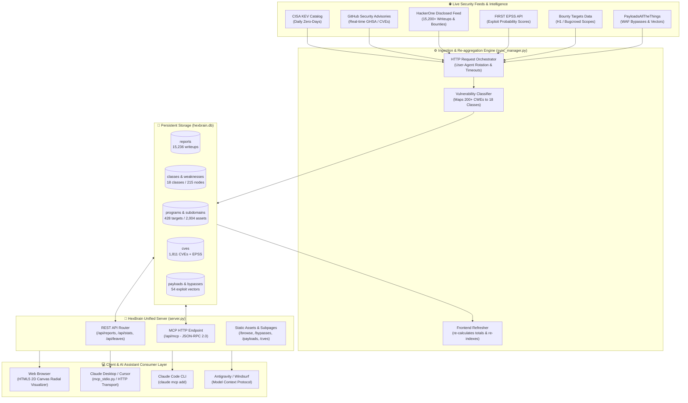

# HexBrain 🧠 — Cyber Threat Intelligence Map & MCP Server

<p align="center">
  
</p>

<p align="center">
  <strong>An interactive cyber intelligence knowledge graph mapping 15,236 disclosed HackerOne bug bounty reports across 428 programs, 215 weaknesses, and 1,811 CVEs scored with CISA KEV and FIRST EPSS exploit likelihoods.</strong>
</p>

<p align="center">
  <a href="https://github.com/Gokul965/HexBrain/releases/tag/v1.0.0"></a>
  <a href="LICENSE"></a>
  </a>
  
  
  
  
  
</p>

---

## Table of Contents

- [Overview](#overview)
- [System Architecture](#system-architecture)
- [Key Features & Visualizer Lenses](#key-features--visualizer-lenses)
- [Multi-Source Live Threat Intelligence Engine](#multi-source-live-threat-intelligence-engine)
- [Model Context Protocol (MCP) Server](#model-context-protocol-mcp-server)
  - [Connecting Claude Desktop & Cursor](#connecting-claude-desktop--cursor)
  - [Connecting Claude Code CLI](#connecting-claude-code-cli)
  - [Available MCP Tools](#available-mcp-tools)
- [REST API Reference](#rest-api-reference)
- [Quick Start & Installation](#quick-start--installation)
- [Project Directory Structure](#project-directory-structure)
- [License & Responsible Use](#license--responsible-use)

---

## Overview

**HexBrain** is an autonomous security research platform and knowledge graph that aggregates, structures, and cross-references publicly disclosed bug bounty write-ups, vulnerability classes, attack surfaces, and in-the-wild CVE exploits.

Unlike static databases, HexBrain features a **live ingestion engine** tracking 6 continuous feeds and an **open Model Context Protocol (MCP) server** allowing AI assistants (Claude, Cursor, Windsurf, Antigravity) to query bug bounty findings, exploit playbooks, bypass methods, and target scopes **directly with zero authentication barriers**.

### Live Metrics at a Glance

* **Disclosed Reports**: **15,236** technical write-ups with full reproduction steps and findings.
* **Total Bounties Mapped**: **$5,039,453+** in actual monetary payouts across 428 bug bounty programs.
* **Vulnerability Classes**: **18** classes (`XSS`, `RCE`, `SSRF`, `SQLI`, `IDOR`, `ACL`, `AUTH`, `CSRF`, `MEM`, `LOGIC`, `TRAV`, `INFO`, `REDIR`, `CRYPTO`, `INJ`, `CONF`, `DOS`, `OTHER`).
* **Weakness Taxonomies**: **215** CWE-aligned weakness definitions.
* **Tracked Targets**: **428** enterprise bug bounty programs (Shopify, Uber, GitLab, Basecamp, Valve, Slack, etc.).
* **Attack Surface**: **2,004** in-scope subdomains and mapped assets.
* **Tracked CVEs**: **1,811** vulnerabilities annotated with CISA KEV (in-the-wild exploitation) and FIRST EPSS probability scores.

---

## System Architecture

The HexBrain system comprises three coordinated layers: an asynchronous **Multi-Source Ingestion Engine**, an indexed **SQLite Persistence Layer**, and a **Unified Backend Server** delivering both an interactive Next.js radial canvas frontend and high-performance JSON-RPC 2.0 MCP endpoints.



---

## Key Features & Visualizer Lenses

HexBrain replicates the exact central radial chord visualizer in HTML5 Canvas 2D with dynamic mathematical layout scaling and three interactive dials:

### 1. Vulnerabilities Lens
- **18 Core Classes**: Inner ring nodes representing exploit categories with thickness proportional to shared co-occurrences.
- **Parametric Sunflower Phyllotaxis**: Report nodes bloom in golden-angle spirals ($\sqrt{N}$ radius scaling) within each weakness leaf.
- **High-Density Strip Compression**: Automatically flattens clusters with $>3,000$ reports into barcode strips to maintain 60 FPS rendering.
- **Particle-Pulsed Bezier Curves**: Dynamic root connectors displaying shared vulnerabilities across reports.

### 2. Programs Lens
- **Honeycomb Lattice ($A-Z$)**: Alphabetical directory of 428 bug bounty targets.
- **Dynamic Asset Surface**: Selecting any program reveals its vulnerability breakdown and mapped subdomains (2,004 monitored hosts).

### 3. CVEs Lens (2000–2026)
- **Clock Dial Timeline**: Concentric annual and monthly dials tracking vulnerabilities across two decades.
- **5 Likelihood Bands**: Segregated by FIRST EPSS exploitation probability and CISA KEV active exploitation markers.

### 4. Interactive Utilities
- **Command Palette (<kbd>F</kbd> Key / Find)**: Instant keyboard-driven fuzzy search modal across write-ups, weaknesses, and targets.
- **Deep Report Reader (`/report/{id}`)**: Full disclosure reader with reproduction steps, severity badges, and impact analysis.
- **Zero Authentication**: Open access for both humans and AI agents without Google OAuth or subscription gates.

---

## Multi-Source Live Threat Intelligence Engine

HexBrain ingests live vulnerability data across 6 continuous security feeds:

| Source | Type | Records | Frequency | Purpose |
|---|---|---|---|---|
| **CISA Known Exploited Vulnerabilities (KEV)** | Official JSON | **1,781** | Daily | Actively exploited zero-days and critical in-the-wild threats |
| **GitHub Advisory Database** | REST API | **30+** | Real-time | Real-time CVEs, GHSA advisories, and ecosystem flaws |
| **HackerOne Disclosed Reports** | Live Feed | **15,236** | Continuous | Real writeups with payouts, upvotes, severity tiers, and PoCs |
| **FIRST EPSS** | REST API | **1,811** | Daily | Empirical 30-day exploit prediction probability scores |
| **Bug Bounty Attack Surfaces** | Scope Feed | **428 targets / 2,004 subdomains** | Continuous | Live scopes across HackerOne, Bugcrowd, and enterprise targets |
| **PayloadsAllTheThings** | Knowledgebase | **54 curated vectors** | Weekly | Tested exploit payloads (XSS, SSRF, SSTI, SQLi, Prototype Pollution) |

### Triggering Live Synchronization

**Via CLI:**
```bash
python3 sync_manager.py
```

**Via REST API:**
```bash
curl -X POST http://localhost:8080/api/sync
```

**Via MCP:**
Call the `sync_live_sources` tool from Claude, Cursor, or Antigravity:
```json
{
  "name": "sync_live_sources",
  "arguments": { "sources": ["all"] }
}
```

---

## Model Context Protocol (MCP) Server

HexBrain features a complete JSON-RPC 2.0 Model Context Protocol implementation (`protocolVersion: 2024-11-05`) exposing **10 specialized security tools** over both HTTP and Standard I/O (stdio).

### Connecting Claude Desktop & Cursor

Add the following to your `claude_desktop_config.json`:

#### Option A: HTTP Transport (Recommended)
```json
{
  "mcpServers": {
    "hexbrain": {
      "url": "http://localhost:8080/api/mcp"
    }
  }
}
```

#### Option B: Standard I/O (stdio) Transport
```json
{
  "mcpServers": {
    "hexbrain": {
      "command": "python3",
      "args": ["/absolute/path/to/HexBrain/mcp_stdio.py"]
    }
  }
}
```

### Connecting Claude Code CLI

```bash
claude mcp add --transport http hexbrain http://localhost:8080/api/mcp
```

---

### Available MCP Tools

| Tool | Parameters | Description |
|---|---|---|
| `search_reports` | `query`, `vulnerability_class`, `program`, `weakness`, `severity`, `limit` | Search 15,236 disclosed HackerOne reports with bounty amounts, upvotes, and findings. |
| `get_report` | `report_id` | Fetch full technical write-up, reproduction steps, and impact assessment for a specific report. |
| `list_classes` | *none* | List all 18 core vulnerability classes with report counts and historical bounties. |
| `list_weaknesses` | `vulnerability_class` | List specific weaknesses, tags, and report frequencies. |
| `list_programs` | `query`, `min_reports`, `limit` | List bug bounty targets, report totals, and mapped attack surface subdomains. |
| `search_payloads` | `query`, `category`, `limit` | Query exploit payloads (XSS, SQLi, SSRF, SSTI, Command Injection, LFI/RFI, XXE). |
| `search_bypasses` | `query`, `protection_type`, `limit` | Search real-world filter, WAF, 2FA/MFA race condition, and rate limit bypasses. |
| `search_cves` | `query`, `exploited_in_wild`, `min_cvss`, `limit` | Search CVE database with EPSS likelihood scores and CISA KEV status. |
| `sync_live_sources` | `sources` | Ingest fresh intelligence from external feeds (CISA KEV, GitHub Advisories, Target scopes, etc.). |
| `get_data_sources_status` | *none* | View live status, record counts, and last synchronization timestamps across all feeds. |

---

## REST API Reference

The server exposes standard JSON REST endpoints queryable by external scripts, tools, or web clients:

| Endpoint | Method | Parameters | Description |
|---|---|---|---|
| `/api/stats` | `GET` | *none* | Returns global platform stats (`reports`, `bounties`, `programs`, `cves`). |
| `/api/reports` | `GET` | `q`, `class`, `program`, `weakness`, `sort`, `limit`, `offset` | Paginated search across all 15,236 disclosed reports. |
| `/api/leaves` | `GET` | `weakness`, `class` | Returns lightweight coordinate and severity tuples for canvas rendering. |
| `/api/classes` | `GET` | *none* | Lists all 18 classes with report tallies and cumulative bounties. |
| `/api/program-dots`| `GET` | `program` | Returns weakness distribution dots for a specific bug bounty program. |
| `/api/subdomains` | `GET` | `program`, `q`, `offset` | Lists in-scope domains and mapped assets for a target. |
| `/api/cve-find` | `GET` | `q` | Fast autocomplete search across 1,811 tracked CVEs. |
| `/api/cve-band` | `GET` | `year`, `month`, `band`, `q` | Queries CVEs within specific timeline segments and likelihood bands. |
| `/api/sources` | `GET` | *none* | Current status, record counts, and metadata for all 6 live feeds. |
| `/api/sync` | `POST` | *none* | Triggers full synchronization across all live feeds. |
| `/api/mcp` | `POST` | JSON-RPC 2.0 payload | Model Context Protocol JSON-RPC 2.0 endpoint. |

---

## Quick Start & Installation

### Prerequisites
* Python 3.10 or higher
* Modern web browser (Chrome, Chromium, Firefox, Edge, Safari)

### 1. Clone the Repository
```bash
git clone https://github.com/Gokul965/HexBrain.git
cd HexBrain
```

### 2. Run the Server
```bash
python3 server.py 8080
```

### 3. Open the Map
Navigate to **`http://localhost:8080`** in your browser.

- Hit <kbd>F</kbd> anywhere on the page to open the **Find** command palette.
- Switch between **Vulnerabilities**, **Programs**, and **CVEs** using the left navigation dial.
- Access the bypass library at [`/bypasses`](http://localhost:8080/bypasses) and payload library at [`/payloads`](http://localhost:8080/payloads).

---

## Project Directory Structure

```text
HexBrain/
├── server.py              # Main HTTP REST API & MCP HTTP Server (Port 8080)
├── mcp_server.py          # Model Context Protocol (MCP) tool execution engine
├── mcp_stdio.py           # Standard I/O MCP transport for local desktop assistants
├── sync_manager.py        # Multi-source live intelligence ingestion & refresh pipeline
├── db.py                  # SQLite schema definition and database connection pool
├── hexbrain.db            # Persistent SQLite database (15,236 reports, 1,811 CVEs)
├── sync_status.json       # Feed synchronization metadata and timestamp ledger
├── graph-data.json        # Compiled radial graph model and top program index
├── index.html             # Main visualizer page (Radial chord wheel & HUD)
├── _next/                 # Production Next.js JavaScript chunks, fonts, and stylesheets
├── pages_data/            # Subpage HTML templates
│   ├── browse.html        # Comprehensive vulnerability & program directory
│   ├── bypasses.html      # WAF and defense evasion knowledgebase
│   ├── payloads.html      # Curated attack vectors and injection strings
│   ├── cves.html          # Annual and monthly CVE timeline dial
│   └── about.html         # Methodology, data sources, and architecture overview
└── logos/                 # Program asset logos (Shopify, Uber, GitLab, Basecamp, etc.)
```

---

## License & Responsible Use

### Responsible Use
HexBrain contains data on real vulnerabilities that were remediated and disclosed by participating organizations. This platform is intended strictly for authorized educational research, defensive security engineering, and penetration testing within explicit program scopes.

### License
Distributed under the **Apache License 2.0**. See [`LICENSE`](LICENSE) for details.
All disclosed reports belong to their respective authors and disclosing bug bounty programs.
